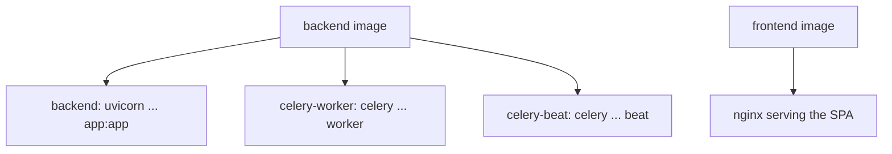

# 10 · Ops, Docker & deploy

How the whole thing runs, gets configured, and ships. Most of this maps cleanly to .NET ops;
the container parts are identical (Docker is Docker).

## Configuration — `.env` + Pydantic settings

All config comes from **environment variables**, loaded and validated by a Pydantic
`BaseSettings` class (`core/config.py`). This is the equivalent of `appsettings.json` +
`IOptions<T>`, but env-first (the 12-factor style):

```python
class Settings(BaseSettings):
    jwt_secret: str = "change-me-..."
    database_url: str = "postgresql+asyncpg://..."
    external_api_timeout_seconds: float = 30.0
    class Config:
        env_file = ".env"
```

Each field reads from an env var of the same name (uppercased). `.env` (git-ignored) holds the
local values. A nice production touch: a validator **refuses to boot** when `APP_ENV != development`
and the JWT secret / MinIO creds are still defaults — so you can't accidentally run prod with
demo secrets. Fail fast and loud beats silently insecure.

## Containers — one image, several roles

The backend has **one** Docker image (`backend/Dockerfile`). Different services run it with
different commands (in `docker-compose.yml`):



`docker-compose.yml` wires up **7 services**: postgres, redis, storage (RustFS, S3-compatible), backend, celery-worker,
celery-beat, frontend — plus the network and volumes between them. `docker-compose up -d` starts
the whole stack locally. This is the dev environment.

Production hardening (a separate `docker-compose.prod.yml`, and the Dockerfiles):
- **Non-root containers** — the backend runs as a dedicated `appuser`, the frontend as
  `nginx`-unprivileged. (A container process running as root that gets compromised is far more
  dangerous.)
- **No `--reload`** — dev uses uvicorn auto-reload; prod runs fixed workers.
- **Healthchecks, restart policies, resource limits**, datastores kept off the host network.
- **`.dockerignore`** so the image doesn't bloat with the local `venv`/`node_modules`.
- **A `model-cache` volume** (`HF_HOME=/models`) shared by the backend and worker, so local
  embedding / re-ranking models download once instead of on every container rebuild.

**Operator tools** live in `backend/app/cli/` and run inside the backend container, e.g.
`docker compose exec backend python -m app.cli.embeddings status` — compare the vector column
with the configured embedding model, and `resize` / `reembed` when switching models
([Building Block 4](blocks/04-retrieval-blocks.md)).

## Observability — you can't operate what you can't see

Three pillars, all present:

1. **Metrics (Prometheus).** The backend exposes `/metrics` with custom counters/histograms
   (`rag_queries_total`, retrieval/generation latency). The worker exposes its own on `:9100`
   (separate process — see the ingestion page). Prometheus would scrape these; Grafana would
   chart them.
2. **Logs (structured + correlated).** Every request gets an `X-Request-ID` and, once
   authenticated, the tenant/user are bound to the logging context, so every log line for a
   request is tagged `[req=... tenant=...]`. That turns "find what happened to this request" from
   archaeology into a grep. (.NET analogy: `ILogger` scopes + a correlation-id middleware.)
3. **Health checks.** `/api/v1/health` for liveness/readiness probes.

The guiding principle the codebase follows: **fail loud in dev, degrade gracefully in
prod — but never silently.** Every caught exception is logged with context; "swallowed" errors
were treated as bugs.

## CI — GitHub Actions

`.github/workflows/ci.yml` runs on every push/PR, with five jobs:
- **Lint** — `ruff` (a fast Python linter/formatter; think StyleCop + analyzers).
- **Frontend** — `npm ci` (installs exactly what `package-lock.json` pins), `npm audit` of the
  shipped dependencies, then `npm run build` (typecheck of the app *and* `vite.config.ts` + bundle).
- **Tests** — spins up real Postgres + Redis service containers, audits every installed Python
  package with `pip-audit`, runs the **migrations** (which creates the `agentrag_app` role +
  RLS), then `pytest`. So CI exercises the real DB and the RLS isolation tests in a clean
  environment, not just mocked unit tests.
- **Helm** — `helm lint --strict` and renders the chart with the default and Claude-only values.
- **End-to-end** — builds the real images and boots the whole `docker-compose.yml` stack, then
  `e2e/run_e2e.py` drives it **through the frontend's nginx**, like a browser: register two
  tenants → upload → the Celery worker extracts, chunks and embeds (local BGE model) → query →
  stream → the second tenant can neither query the first tenant's collection nor see its data.
  Generation goes to `e2e/stub_llm.py`, a small OpenAI-compatible server registered through
  `LLM_ENDPOINTS` like any client endpoint, so the job needs no API key and costs nothing. The
  stub repeats the test document's secret fact only if it appears in the prompt — proof that
  retrieval found the chunk and the generator passed it on.

Tracing every hop the e2e job crosses surfaced three bugs no unit test could: SSE answers were buffered by nginx
and arrived in one lump (fixed with `X-Accel-Buffering: no`, `app/api/sse.py`), the WebSocket
route wasn't proxied with the upgrade handshake (`nginx.conf`), and — found by the first CI run —
the `minio/minio` image no longer exists on Docker Hub (MinIO stopped publishing free images in
2025), so `docker compose up` failed for everyone. The `storage` service now runs RustFS
(Apache-2.0, MinIO-compatible API and ports); the app talks plain S3 through the `minio` client
library, so nothing else changed. Its data lives in a new `storagedata` volume — blobs in an old
`miniodata` volume can be copied over with any S3 tool (`rclone sync`, `aws s3 sync`).

**Supply chain.** Both audits fail the build on a known-vulnerable dependency, and
`.github/dependabot.yml` opens weekly grouped update PRs (pip, npm, Actions, base images) that
this same CI vets. The document parsers (pypdf, Pillow, python-docx, openpyxl) matter most —
they parse files attackers choose — and `tests/test_extractors.py` builds real PDF/DOCX/XLSX/
image files in memory so bumping them is safe. Backend images install **CPU** PyTorch first
(`TORCH_INDEX_URL` build arg); PyPI's default Linux wheel is the CUDA build, several GB of NVIDIA
libraries a CPU server never uses.

Tests use **pytest** (the standard Python test framework — like xUnit). Many are pure unit tests
with fakes/mocks; a few are integration tests that talk to the live DB and `skip` themselves when
no DB is reachable.

## Deploy targets

- **Docker Compose (prod)** — `docker-compose -f docker-compose.prod.yml up -d`. Good for a
  single VM.
- **Kubernetes (Helm)** — `deploy/helm/agentrag` is a minimal chart: Deployments for backend /
  worker / beat / frontend, a Services pair, an env **Secret**, and a **pre-upgrade migration
  Job** (so migrations run once per release, not once per replica — a classic footgun). Postgres
  / Redis / MinIO are expected to be managed services wired via `values.yaml`.
  - `models.*` picks the LLM / fast / embedding / reranker models and `LLM_ENDPOINTS`; `extraEnv`
    passes any other setting. Empty values keep the app defaults (OpenAI).
  - `modelCache` mounts `HF_HOME=/models` for local models: an `emptyDir` per pod by default,
    or one shared PVC (`persistence.enabled`; ReadWriteMany when pods span nodes).
  - The Secret is itself a pre-install hook (weight -10): hooks run *before* regular resources,
    so a migration Job reading a normal Secret hangs on the very first install. It is named
    `<release>-agentrag-config` (0.1.0's `-env` would be deleted by the upgrade that replaces
    it), and `helm uninstall` leaves it behind.
  - `podSecurityContext.fsGroup: 10001` makes the model-cache PVC writable by the non-root user.

## Checking a client's model setup

`python -m app.cli.smoke` (in Docker: `docker compose exec backend python -m app.cli.smoke`)
calls the configured models for real — complete, stream, the RAG pipeline over two in-memory
passages, and the tool-calling agent loop — and checks the embedding model's output size. Run it
after setting up or changing a client's keys, models or `LLM_ENDPOINTS`; it prints PASS/FAIL per
check and the estimated cost (about one to two cents on Claude). `--model` checks other models,
`--no-agent` skips the agent check.

## The "why it looks like this" meta-point

A lot of the non-obvious code (the non-owner DB role, the per-process event loop, the capped
upload reader, the fail-fast secret check, the prefork metrics exporter) exists because of bugs
or risks found by **running the system and watching it**, not by reading code. The single most
valuable habit this project teaches: **verify against the live stack.** Unit tests are necessary
but they passed while the real system was broken (inert RLS, the chunker infinite loop, the
event-loop wedge). If you take one operational lesson away, take that one.

---

Prev: [The frontend](10-frontend.md) · Next: [Build it yourself →](12-build-it-yourself.md)
